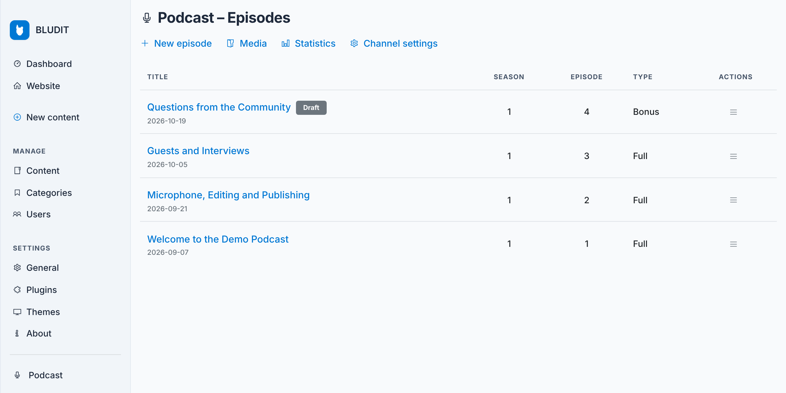
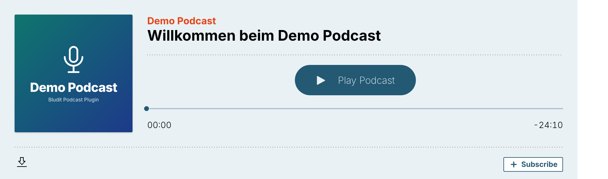
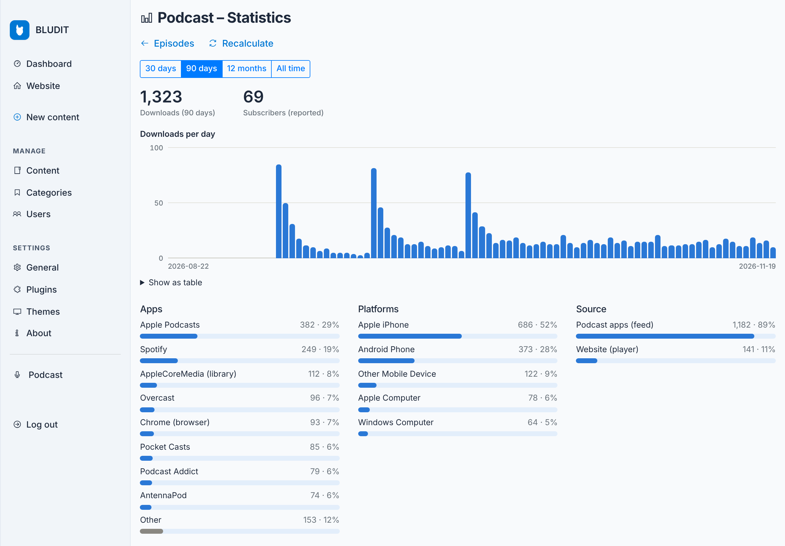
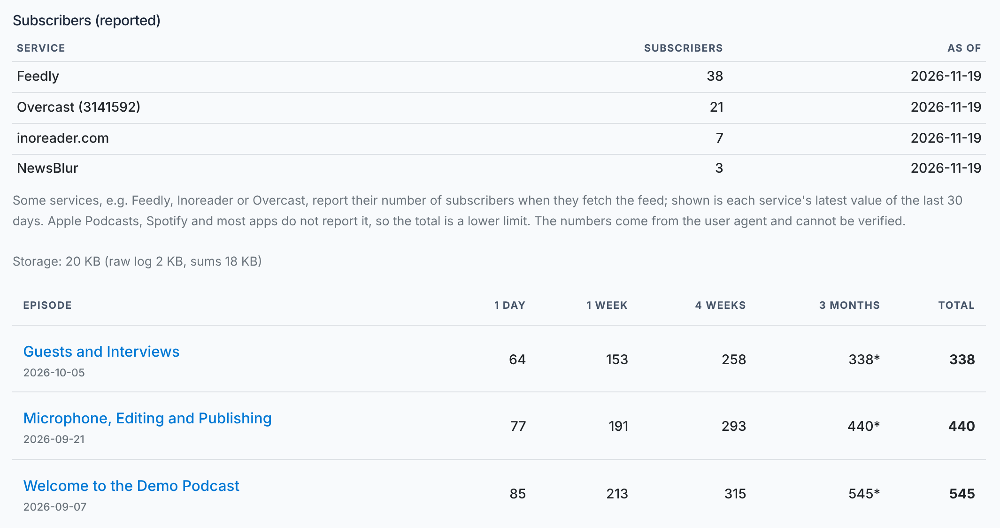
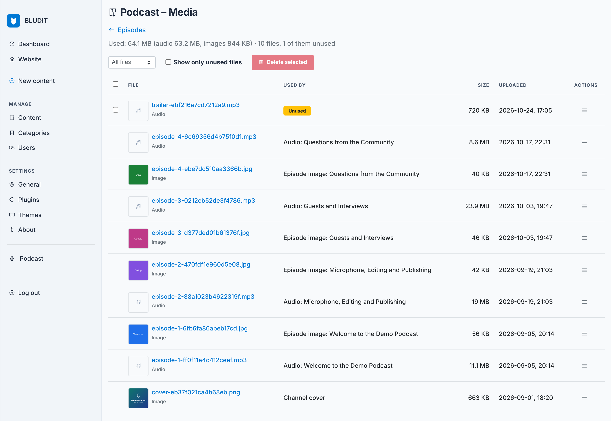
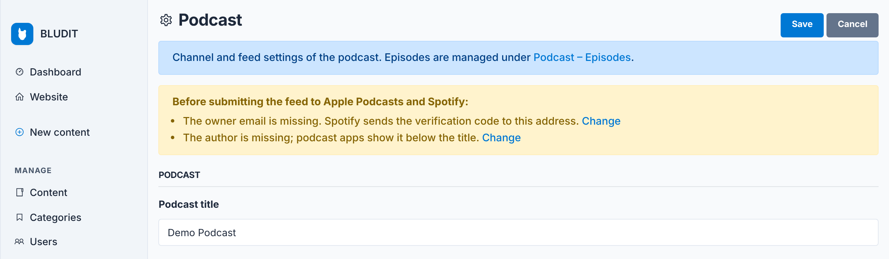
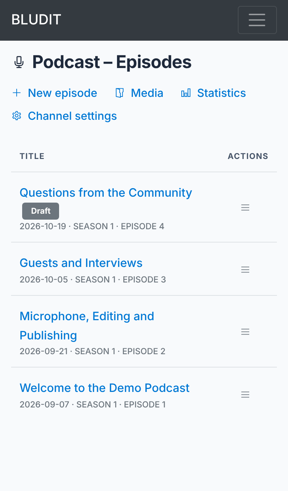
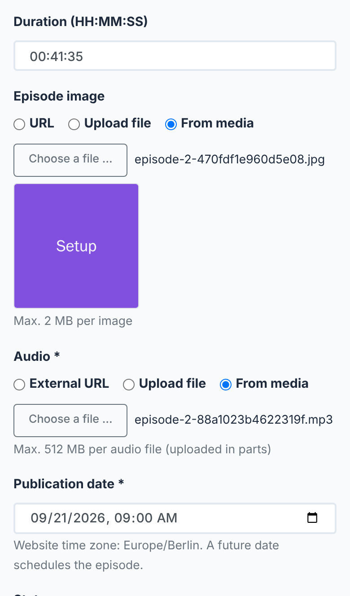

# Bludit Plugin: Podcast

Run a podcast with [Bludit](https://www.bludit.com): manage episodes in the admin panel, publish an RSS feed that is ready for Apple Podcasts and Spotify, play episodes on your site with the Podlove Web Player and, if you like, count downloads – all served from your own server.

## Features

- **Episodes are regular Bludit pages** with the tag `podcast`, so they work with your theme, categories, tags and the Bludit editor. Episode details (number, season, type, duration, audio, artwork) are stored as Bludit custom fields.
- **Admin page** to create, edit and delete episodes – drafts and scheduled episodes included. Upload audio and episode artwork or link external files; large audio files are uploaded in parts with a progress bar, also with PHP's default limits, and all uploads are checked for size, file type and content. The duration is read from the audio file and the next episode number is suggested. A media page shows all uploads with their usage, deletes unused files and lets you reuse them. Matches the Bludit admin look and works on phones.
- **Channel settings** with a cover upload that checks Apple's requirements, the Apple Podcasts category list, podcast type and links to your podcast on Apple Podcasts, Spotify, Pocket Casts, Deezer and Castbox. A feed check shows what is still missing before you submit the feed to Apple Podcasts or Spotify.
- **RSS feed** at `/podcast.xml` (configurable) with iTunes tags, show notes as HTML, file sizes of external audio files and Podcasting 2.0 tags (`podcast:guid`, `podcast:locked`). Unchanged feeds are answered with `304 Not Modified`, and the number of episodes in the feed can be limited.
- **Player on episode pages:** Podlove Web Player 5 served from your own server – no CDN, no third-party requests – with a subscribe button for podcast apps and services, or a simple HTML5 player.
- **Download statistics (optional):** downloads per episode after 1 day, 1 week, 4 weeks and 3 months and in total, a history chart, apps, platforms and sources, and the subscribers that services like Feedly report – counted on your own server similar to the IAB guidelines, no cookies, no IP addresses stored, no third parties.
- **English and German:** the admin interface follows the language of your Bludit site.
- Works with Bludit installed in a subdirectory.

## Screenshots

**Episode page with the Podlove Web Player**

**Download statistics: downloads per day, by app, platform and source**

**Downloads of each episode in its first days, weeks and months, and the subscribers reported by services**

**Media page: every upload with its usage, unused files can be deleted**

**Feed check in the channel settings**

| Episode list on a phone | Episode image and audio from the media on a phone |
|---|---|
|  |  |

## Installation

1. Download `podcast-<version>.zip` from the [latest release](https://github.com/larsauswsw/bludit-plugin-podcast/releases/latest) and unzip it.
2. Copy the `podcast` folder into `bl-plugins/` of your Bludit installation.
3. In the Bludit admin panel, go to **Settings → Plugins** and activate **Podcast**.
4. Open **Podcast → Channel settings**, fill in your podcast details and submit the feed address shown there to Apple Podcasts, Spotify and other directories.

Audio files are uploaded in parts with a progress bar, so PHP's default upload limits are enough. The [documentation](podcast/README.md) explains all settings, the feed and the player.

**Updating:** copy the `podcast` folder of the new release over the existing one. Episodes, settings and uploads are stored in `bl-content/` and are kept. See the [changelog](CHANGELOG.md) for what changed.

## Requirements

- Bludit 3.19 – 3.22
- PHP 8.0 or newer with the `fileinfo` extension (for uploads)

## License

The plugin is released under the [MIT License](LICENSE). The bundled Podlove Web Player is MIT-licensed as well (`podcast/player/LICENSE`), as are the lists of the Open Podcast Analytics Working Group used by the download statistics (`podcast/data/LICENSE`).

---

## Deutsch

Podcast-Plugin für [Bludit](https://www.bludit.com): Episoden im Admin-Bereich verwalten, RSS-Feed für Apple Podcasts und Spotify, Podlove Web Player direkt vom eigenen Server – ohne CDN und ohne Drittanbieter. Episoden sind normale Bludit-Seiten mit dem Tag `podcast`. Auf Wunsch zählt das Plugin Downloads auf dem eigenen Server (IAB-ähnlich, ohne Cookies, ohne gespeicherte IP-Adressen). Die Oberfläche folgt der Sprache der Bludit-Website: Deutsch oder Englisch.

**Installation:** `podcast-<version>.zip` aus dem [neuesten Release](https://github.com/larsauswsw/bludit-plugin-podcast/releases/latest) entpacken, den Ordner `podcast` nach `bl-plugins/` kopieren und unter **Einstellungen → Plugins** aktivieren. Für Updates den Ordner einfach ersetzen; Episoden und Einstellungen bleiben erhalten. Voraussetzungen: Bludit 3.19–3.22, PHP 8.0 oder neuer. Lizenz: MIT.
